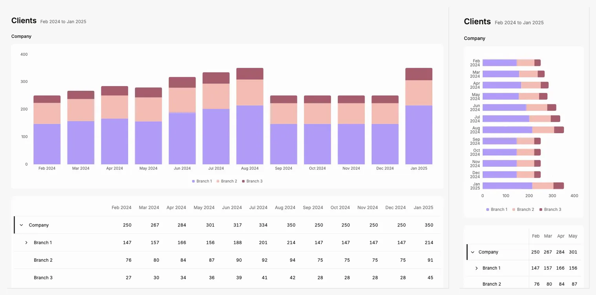

# Nevis frontend take-home

A Book of business dashboard over Feb 2024 to Jan 2025 with a stacked bar chart over time and a per-month detail table with expandable rows, drilling from company to branch, adviser, and acquisition channel.

Review copy. The design and client figures belong to Nevis; this repository is for their evaluation only.



Desktop and mobile, 15 seconds. [MP4](docs/media/dashboard-demo.mp4) · [Still frame](docs/media/dashboard-demo-poster.png)

## Stack

- **Client:** React 19, TypeScript 7 (strict), Vite 8, `react-router` (`createBrowserRouter`).
- **API:** Express in the same repo (`apps/api`), serving `GET /api/dashboard/:year` and `GET /api/health`.
- **Contract:** One Zod contract in `packages/shared`, imported by server and client; mock payload at `@nevis/shared/payload`.
- **Chart and styling:** Recharts 3 through shadcn/ui Chart, Tailwind v4 for component tokens and layout, CSS modules for the page shell.
- **Client data:** SWR, keyed by fiscal year.
- **Tooling:** Biome for lint and formatting, vitest for unit tests, Playwright for the browser suite, Fallow for code analysis.

## Run it

Install dependencies once from the root, then start both servers:

```bash
npm install
npm run dev
```

The web client runs on `http://localhost:5173` and the API on `http://localhost:3000`. The browser suite needs Chromium installed once via `npm exec playwright install chromium` and starts both servers itself.

```bash
npm run test       # vitest unit suite
npm run test:e2e   # Playwright browser suite
npm run check      # Biome lint, format, and import order
npm run typecheck  # TypeScript across workspaces
npm run build      # production build for web and api
npm run analyze    # Fallow dead code, duplication, and complexity
```

CI runs `check`, `typecheck`, `test`, `analyze`, `build`, and the Chromium browser suite on pull requests and pushes to `main`.

## What to look at

- **Treegrid keyboard model:** `ArrowRight` and `ArrowLeft` expand and collapse rows, `Enter` selects, and row hierarchy is exposed through `aria-level`, `aria-posinset`, `aria-setsize`, `aria-expanded`, and `aria-selected`.
- **Chart keyboard path:** One focus stop on the plot where arrow keys step across months and a polite live region announces each month and its series values.
- **375px layout:** Below `640px` the chart turns horizontal with month rows along the vertical axis, while the treegrid pins and caps the sticky name column with short month headers.
- **Two test suites:** 74 unit cases across six files covering the pure modules, plus 43 Playwright browser specs across two files covering interactions, states, ARIA snapshots, and layout.

## Docs

- **[docs/brief.md](docs/brief.md):** The task brief, requirements, Figma links, and verbatim payload.
- **[docs/decisions.md](docs/decisions.md):** The calls, the assumptions behind them, and what I think Nevis got wrong.
- **[docs/context.md](docs/context.md):** Architecture decisions, design facts, payload arithmetic notes, and open questions.

## Open questions

The brief calls the monthly numbers figures and the design prints them as plain integers. Whether they are client counts or money is unresolved, and the payload is served unchanged.
The full list is in [docs/decisions.md](docs/decisions.md).

## Next

- Add a data-quality note in the UI on months where child sums disagree with the parent row.
- Run the focus-visible assertion in Firefox and WebKit, where the heuristic differs from Chromium.
